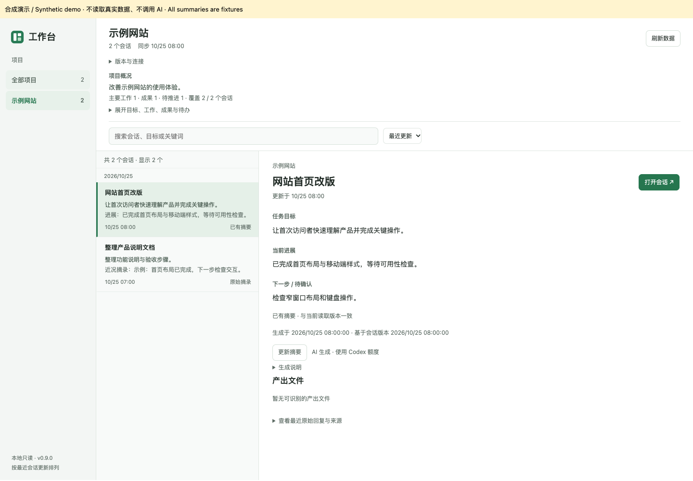

# Codex Workbench · 任务回顾与产出工作台

A local Codex desktop plugin for finding old tasks, understanding progress, and browsing outputs.

**Beta · macOS validated · Community project, not an official OpenAI product.**



## 功能

- 在 Codex 导航中打开工作台，按正式项目和会话更新时间浏览。
- 查看任务目标、进展、下一步与项目综合概况；摘要按需生成，过期保留旧版。
- 仅引用的 skill 和指令文档默认收在参考资料；有明确写入记录的文件仍作为产出。
- 按目录和确切同名组织文件格式，使用独立标签页预览 HTML/draw.io 等产出。
- 搜索标题、初始需求和已有摘要；中英文界面自动适配，也可手动切换。
- 首次可选择生成最近会话与所属项目摘要，或跳过。

**读取和搜索不调用模型。生成/更新摘要会发送部分会话消息给当前 Codex 账号使用的 OpenAI 模型，并使用账号额度。项目、聊天和摘要内容不因切换界面语言自动翻译。**

## 安装

需要 Node.js 20+、支持 `plugin` 命令的 Codex CLI，以及已登录的 Codex 桌面端。macOS 已验证；Windows/Linux 暂不保证。当前开发验证版本为 Node 26、Codex CLI 0.164.0-alpha.11.1；本项目读取的本地数据格式和宿主扩展可能随 Codex 更新改变。

```sh
git clone https://github.com/wangbingwf/codex-workbench.git
cd codex-workbench
npm run preflight
codex plugin marketplace add . --json
codex plugin add codex-workbench@codex-workbench-community --json
```

无须 `npm install`，运行时依赖随包提供。保留克隆目录，不要安装后移动。重开工作台，必要时完全退出 Codex 后重开，在「版本与连接」确认版本一致。若桌面进程找不到 `node` 或 `codex`，先修复桌面进程 PATH；命令行可用不代表桌面环境相同。

## 脱敏演示

```sh
npm run demo
```

打开终端给出的本机地址。演示使用**完全合成的数据和固定摘要**，不读取 Codex，不调用模型，不展示私人文件；不能用来证明真实 AI 摘要或原生文件预览已经验收。

## 更新和卸载

```sh
git pull --ff-only
codex plugin add codex-workbench@codex-workbench-community --json
```

重开工作台并核对版本，不手动覆盖插件缓存。回退前先通过 `git log --oneline` 确认目标版本，在无本地修改时检出目标提交，再重新安装；不要丢弃自己的改动。

```sh
codex plugin remove codex-workbench@codex-workbench-community --json
```

卸载不保证删除缓存。数据位于宿主提供的插件数据目录（环境变量 `WORKBENCH_DATA_DIR`，由 `${PLUGIN_DATA}` 传入）；无宿主数据目录时回退 `~/.codex/workbench-data`。退出 Codex 后，只将已确认属于本插件的缓存目录移至废纸篓，不要删除整个 `~/.codex`。缓存清理后重新生成会再次使用额度。

## 隐私和限制

- 列表仅读取本设备非归档、非子代理会话；无法识别的项目归属显示未归类，不按目录猜测。
- 搜索不是完整会话全文搜索；文件提取也可能遗漏脚本间接生成的文件。
- AI 摘要只基于部分消息，可能遗漏或出错；保留来源供核对。
- 预览绑定本机；原始 HTML 文件可自带脚本和外部资源，打开后可能联网。
- 本项目不包含云端同步、统计采集或独立模型计费服务。

详见 [数据处理说明](docs/DATA-PRACTICES.md)。本地缓存不是加密保险库。

## 开发和反馈

```sh
npm run build
npm test
```

测试使用合成数据；本机真实 Codex 的加载、导航和预览需要单独验收。报告问题请使用 [Issues](https://github.com/wangbingwf/codex-workbench/issues)，提供系统、Node/CLI和界面/服务版本及脱敏复现步骤，**不要上传真实会话、摘要缓存、凭据或带令牌的预览链接**。

代码采用 [MIT](LICENSE)。第三方依赖保持各自许可，见 [依赖声明](plugins/codex-workbench/vendor/README.md)。

## English quick start

Clone this repository, run `npm run preflight`, then the two `codex plugin` installation commands above. No npm dependencies need installation. Keep the checkout in place and reopen Codex. AI summaries require explicit consent, send selected conversation excerpts to OpenAI, and use your Codex allowance. `npm run demo` serves synthetic data only. This beta is validated on macOS; other platforms and future Codex versions are unverified. Uninstall with the removal command above; local summary caches may remain. Report only redacted issues. The code is MIT licensed, with separate third-party notices.
